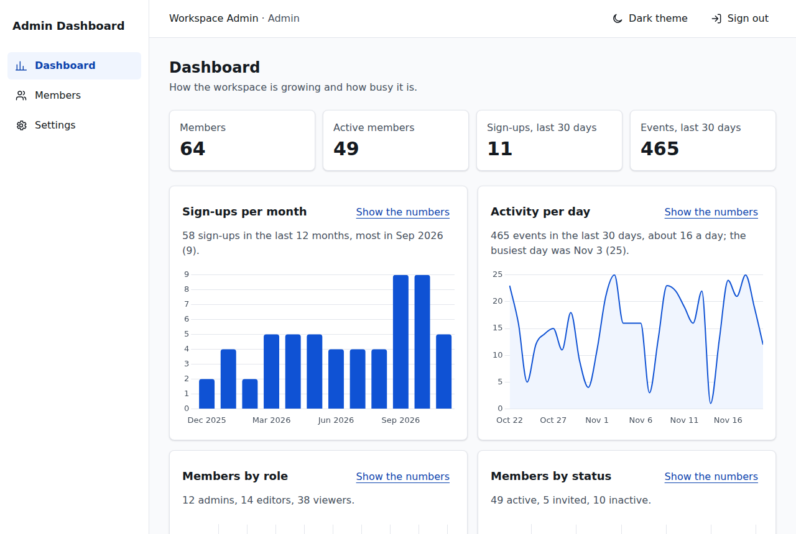
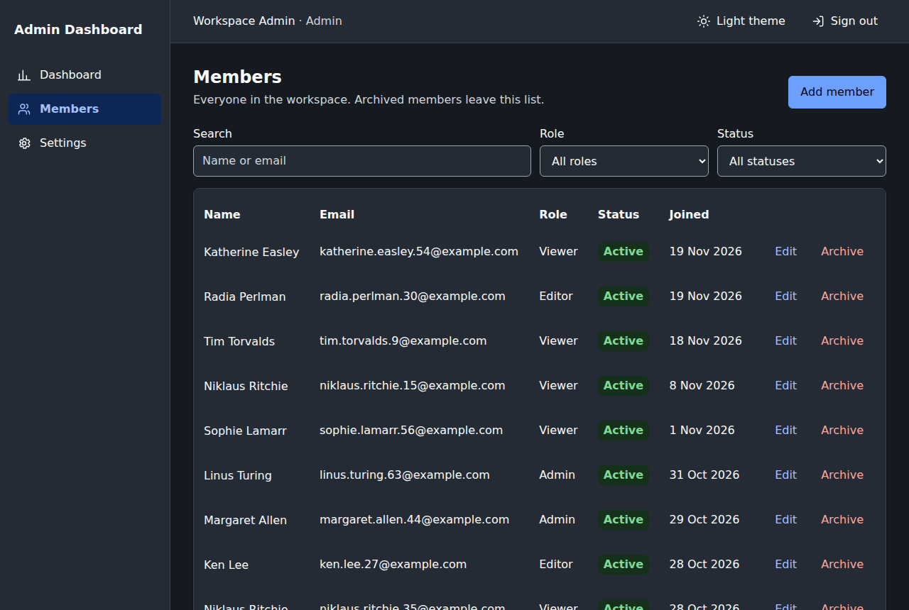
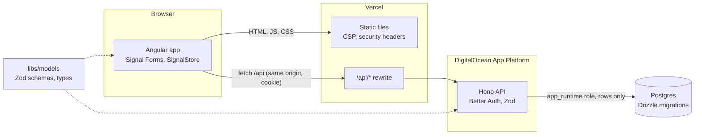

# Admin Dashboard

An admin dashboard for a made-up workspace: sign in, see how the workspace grows on four charts, manage its members, change its settings. It is an Nx monorepo with an Angular front end and a small Hono API on Postgres, built to show how I put together a front end that is fast, accessible and safe by default.



## Try it

Sign in with the demo account, which can look at everything and change nothing:

| Email              | Password              |
| ------------------ | --------------------- |
| `demo@example.com` | `look-but-dont-touch` |

The demo data is put back on every deploy of the API.

## What it shows

- **Angular 22, zoneless.** Signal inputs and outputs, `computed`, `linkedSignal`, `httpResource`, the built-in control flow, standalone components, lazy routes. NgRx SignalStore holds the session and the members list.
- **Signal Forms with one schema.** Every form (sign-in, member, settings, password) is a Signal Form validated by a Zod schema in `libs/models`. The API validates the same request with the same schema, and errors only the server can find (an email already in use, a wrong current password) come back onto the same field.
- **Design tokens and PrimeNG.** `libs/design-system` maps PrimeNG's Aura preset onto the roles of [`@a.incantalupo/design-tokens`](https://www.npmjs.com/package/@a.incantalupo/design-tokens). Light and dark switch with `data-theme`, without a flash on load.
- **Charts with a text alternative.** Chart.js through PrimeNG, coloured from the tokens. Each chart has a one-line summary, and its numbers are always in a table: read by screen readers, shown on screen with one click.
- **Accessibility.** Labels and linked error messages on every field, focus on the first invalid field and on the new page after navigation, a skip link, 16px text, 44px targets, and a phone layout that holds at 200% text size.
- **A small first load.** The sign-in page ships Angular and nothing else (about 95 KB compressed); PrimeNG, its theme and Chart.js load after sign-in.
- **A careful API.** Hono on Node with Better Auth, Drizzle and Postgres. See the security model below.



## Architecture



The browser only ever talks to the front end's own origin. Vercel forwards `/api/*` to the API, so the session cookie is first-party and `SameSite=Lax` works.

| Path                   | What                                                                   |
| ---------------------- | ---------------------------------------------------------------------- |
| `apps/admin-dashboard` | The Angular app                                                        |
| `apps/api`             | The Hono API, Drizzle schema and migrations, seed and database scripts |
| `libs/models`          | Zod schemas and types shared by both apps                              |
| `libs/design-system`   | PrimeNG preset on the design tokens, global styles, chart colours      |

## Security model

| Concern           | How                                                                                                                                                     |
| ----------------- | ------------------------------------------------------------------------------------------------------------------------------------------------------- |
| Session           | Better Auth session in an `HttpOnly`, `Secure`, `SameSite=Lax` cookie. Nothing in `localStorage`. 8 hours, renewed hourly while in use.                 |
| Sign-in           | One message for an unknown email and a wrong password. Failures are counted in Postgres: 5 per account and 20 per IP in 15 minutes.                     |
| Library routes    | Better Auth runs as a library; its HTTP handler is never mounted, so sign-up, reset and OAuth endpoints don't exist.                                    |
| Roles             | `admin` and `viewer`, checked by one middleware on every route: reads need a session, writes need an admin. Angular's guards only shape the UI.         |
| Password change   | Needs the current password (failures count like failed sign-ins) and signs out the other sessions. The demo account can't change its password.          |
| Input             | Every body, query and path parameter goes through a Zod schema; failures answer `422` with field messages.                                              |
| Cross-site writes | CORS allows only the front end's origin, and every write must carry a matching `Origin` header.                                                         |
| Errors            | `application/problem+json`, never a stack trace.                                                                                                        |
| Abuse             | Rate limit on writes, 16 KB body limit.                                                                                                                 |
| Headers           | CSP (`default-src 'none'` on the API; a hashed inline script on the front end), HSTS, `nosniff`, no referrer, no framing.                               |
| Database          | The API connects as `app_runtime`, which reads and writes rows and can't change tables. Migrations run as the owner. Members are archived, not deleted. |
| Personal data     | Logs hold method, route pattern, status and time only. The throttle stores HMACs of emails and IPs, never the values.                                   |
| Secrets           | Only in environment variables. See `apps/api/.env.example`.                                                                                             |

The tests check this: every write route is refused to a viewer (the list of routes comes from the app itself, so a new route can't be forgotten), the login limits, the password change rules and the error format.

## Run it locally

You need [mise](https://mise.jdx.dev) (or Node 26 and pnpm 12) and Docker.

```sh
mise install
pnpm install
docker compose up -d                    # Postgres on localhost:5432
cp apps/api/.env.example apps/api/.env  # then fill BETTER_AUTH_SECRET and SEED_ADMIN_PASSWORD
pnpm db:migrate                         # tables, as the owner
pnpm db:app-role -- --yes               # the API's own role
pnpm db:seed                            # made-up workspace, demo and admin logins
pnpm dev                                # API on :3100, app on http://localhost:4300
```

Sign in as `demo@example.com` (read-only) or `admin@example.com` with your `SEED_ADMIN_PASSWORD`.

## Checks

```sh
pnpm lint        # ESLint (with Angular template accessibility rules) and Prettier
pnpm typecheck
pnpm test        # Vitest: shared schemas, API on an in-memory Postgres (PGlite), Angular units
pnpm build
```

CI runs the same on every push. Deploys run from `main` only: Vercel builds the front end, and `.github/workflows/deploy.yml` migrates the database, ships the API image to DigitalOcean and resets the demo data.

## Licence

MIT
